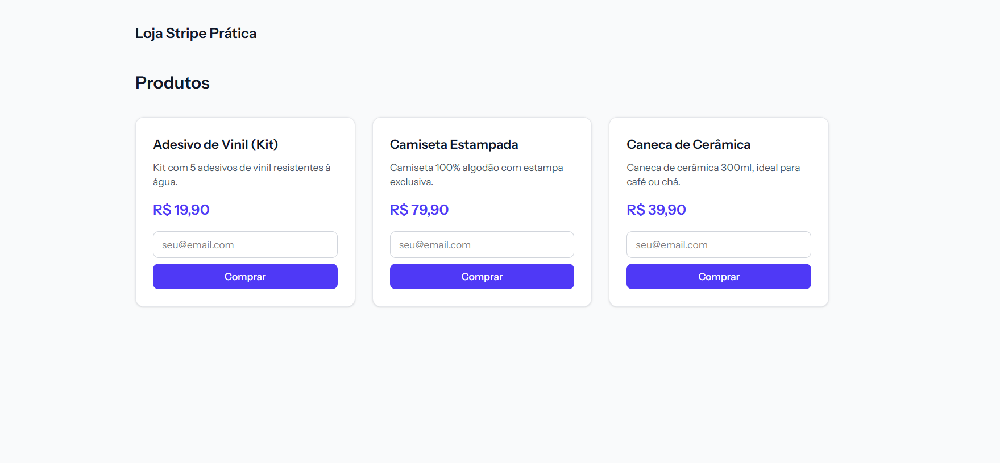
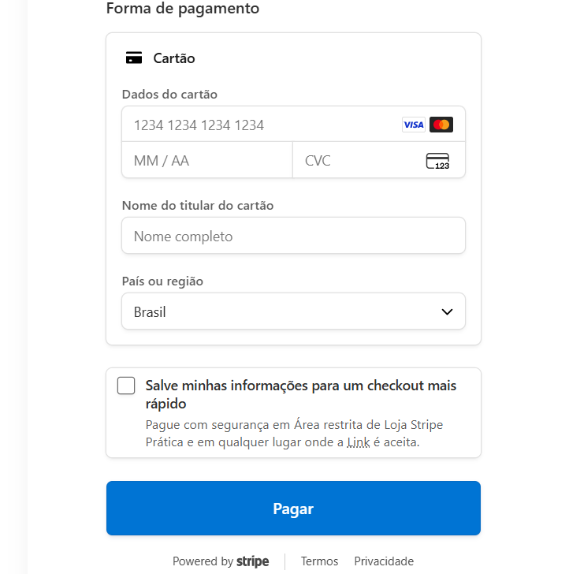
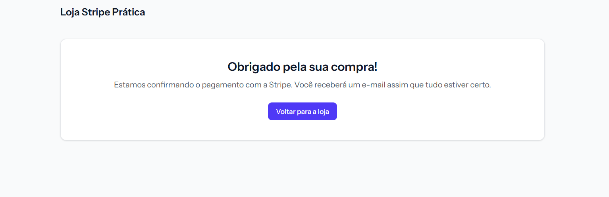

# Loja Stripe Prática

Projeto de estudo criado para praticar integração de pagamentos com o [Stripe](https://stripe.com) em Laravel — checkout de compra única (modo de teste), com confirmação de pagamento via webhook.

## O que o projeto cobre

- Catálogo público de produtos (Livewire + Tailwind CSS)
- Checkout via **Stripe Checkout Session** (modo `payment`, compra única)
- Confirmação de pagamento assíncrona via **webhook do Stripe**, com verificação de assinatura (`Stripe-Signature`) — nenhum pedido é marcado como pago sem uma assinatura válida
- Preço armazenado em centavos (`price_cents`), evitando problemas de arredondamento com float
- Suite de testes automatizados (Pest), incluindo o caso mais importante do projeto: um webhook com assinatura **inválida** é rejeitado com `400` e o pedido permanece `pending`

## Capturas de tela

| Catálogo | Checkout (Stripe) | Confirmação |
|---|---|---|
|  |  |  |

## Stack

- Laravel 13 / PHP 8.4
- Livewire (componentes single-file)
- [stripe/stripe-php](https://github.com/stripe/stripe-php)
- Pest (testes)
- Tailwind CSS + Vite

## Rodando localmente

1. Instale as dependências:
   ```bash
   composer install
   npm install && npm run build
   ```

2. Copie o `.env.example` para `.env` e gere a chave da aplicação:
   ```bash
   cp .env.example .env
   php artisan key:generate
   ```

3. Configure suas chaves de teste do Stripe no `.env` (disponíveis em [dashboard.stripe.com/test/apikeys](https://dashboard.stripe.com/test/apikeys)):
   ```
   STRIPE_KEY=pk_test_...
   STRIPE_SECRET=sk_test_...
   STRIPE_WEBHOOK_SECRET=whsec_...
   ```

4. Rode as migrations e o seeder (popula 3 produtos de exemplo):
   ```bash
   php artisan migrate --seed
   ```

5. Para testar o fluxo de webhook localmente, use o [Stripe CLI](https://stripe.com/docs/stripe-cli):
   ```bash
   stripe listen --forward-to SEU-DOMINIO-LOCAL/stripe/webhook
   ```
   O comando imprime um `whsec_...` — use esse valor como `STRIPE_WEBHOOK_SECRET` enquanto estiver testando (ele muda a cada nova sessão do `stripe listen`).

6. Para simular um pagamento, use o cartão de teste oficial do Stripe: `4242 4242 4242 4242`, qualquer data de validade futura, qualquer CVC e CEP.

## Testes

```bash
composer test
```

Roda Pint (estilo de código), PHPStan (análise estática) e a suite Pest — incluindo os testes que simulam o SDK do Stripe sem bater na API real, tanto pro fluxo de criação de checkout quanto pra verificação de assinatura de webhook (válida e forjada).

---

Projeto de estudo/portfólio, desenvolvido com apoio do [Claude Code](https://claude.com/product/claude-code).
